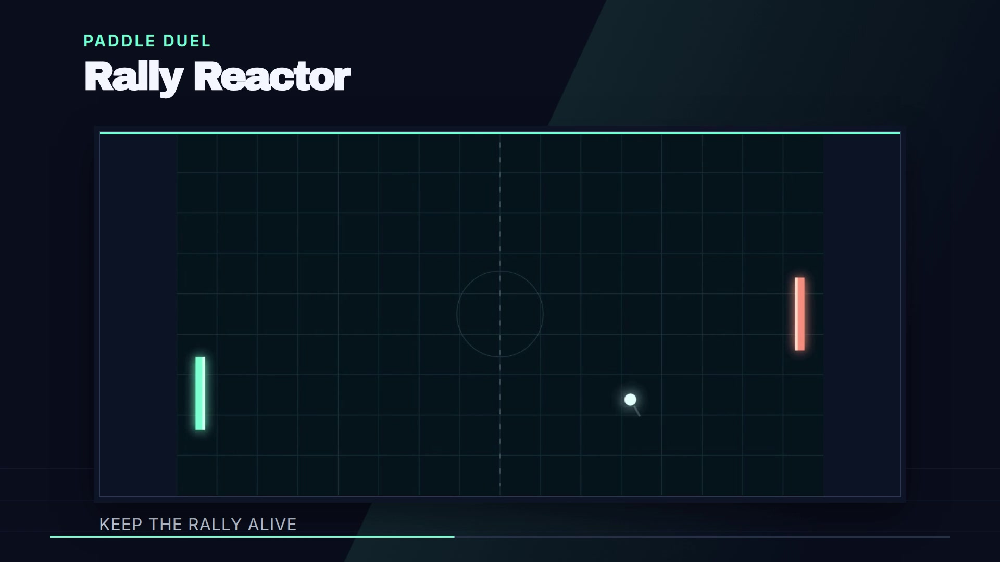

# HyperFrames Arcade Game Showcase

[**▶ Watch the showcase on GitHub Pages**](https://nateofspades.github.io/Hyperframes_Arcade_Games_Showcase/)

Editable HyperFrames source code for a promotional video featuring eight original browser-based arcade games by Nathan Burns (`nateofspades`). This repository preserves the **existing** showcase: its HTML compositions, CSS, GSAP animation code, gameplay recordings, stills, original instrumental music and production scripts. It does not recreate the video from its rendered MP4.



## Watch or download the video

[**Download the revised showcase MP4**](https://github.com/nateofspades/Hyperframes_Arcade_Games_Showcase/releases/download/showcase-video-2026-10-23/Arcade_Games_Showcase-2026-10-23T21-07-10-088Z.mp4) — 90 seconds, 1080p, 30 FPS, with audio.

Watch it in the [GitHub Pages video player](https://nateofspades.github.io/Hyperframes_Arcade_Games_Showcase/), or use the MP4 download above. The page also links to all eight playable games. Deployment copies the verified [GitHub release asset](https://github.com/nateofspades/Hyperframes_Arcade_Games_Showcase/releases/tag/showcase-video-2026-10-23) into the Pages artifact so the player streams directly from Pages, not a release-download redirect. Finished MP4s remain outside Git history.

## Overview

The reference film is 90 seconds, 1920 × 1080, 30 FPS, with H.264 video and AAC stereo audio. It combines real gameplay with dark arcade styling, animated titles, directional/pixel transitions and an original procedural soundtrack. No voiceover is used.

| Game | Reference scene | Play |
| --- | --- | --- |
| 4 Block Theory | 5–14 s | [Browser game](https://nateofspades.github.io/4_Block_Theory_Game/) |
| Chromatic Cure | 14–23 s | [Browser game](https://nateofspades.github.io/Chromatic_Cure_Game/) |
| Rally Reactor | 23–32 s | [Browser game](https://nateofspades.github.io/Rally_Reactor_Game/) |
| Orb Onslaught | 32–41 s | [Browser game](https://nateofspades.github.io/Orb_Onslaught_Game/) |
| Float Tweet Bounce | 41–50 s | [Browser game](https://nateofspades.github.io/Float_Tweet_Bounce_Game/) |
| Serpent Supper | 50–59 s | [Browser game](https://nateofspades.github.io/Serpent_Supper_Game/) |
| BrikaVolt | 59–68 s | [Browser game](https://nateofspades.github.io/BrikaVolt_Game/) |
| Aim Alley Arcade | 68–83 s: Target Practice, Moving Targets, Precision Shooting | [Browser game](https://nateofspades.github.io/Aim_Alley_Arcade_Game/) |

The opening runs 0–5 seconds; the final eight-game grid and invitation run 83–90 seconds. See [the decoded reference contact sheet](docs/images/original-contact-sheet.jpg).

## Technology and structure

HyperFrames renders HTML/CSS and paused, seekable GSAP timelines frame by frame into video. The editable composition—not the MP4—is the source of truth. CLI version **0.8.186** is pinned in project commands.

- `index.html`: 90-second master composition; this is **not a published website**.
- `compositions/`: original opening, ending, eight game scenes and transition components. CSS and animation JavaScript are embedded in these HTML templates; there are no missing external CSS files.
- `assets/footage/`: ten normalized gameplay clips, plus preserved original MP4 takes.
- `assets/stills/`: eight real extracted gameplay images.
- `assets/arcade-circuit.wav`: original 90-second instrumental; editable synthesis in `scripts/music.js`.
- `assets/gsap.min.js`: local animation runtime with its original license header.
- `scenes.json`, `STORYBOARD.md`, `SPEC.md`: reference timing, layout and production decisions.
- `scripts/`: source verification, bounded audits, preview/render helpers and optional capture tools.
- `docs/`: editing guide, media checksums, original-video metadata, provenance and future website plan.
- `renders/`, `evidence/`, `.validation/`: ignored local outputs; never committed.

## Dependencies and installation

Required: Node.js 22 or newer with npm, Python 3, FFmpeg/FFprobe, and the HyperFrames-managed Chromium. Python helpers use only the standard library. Rendering is local; no paid cloud-render account is required.

Install Node.js through its official installation instructions for your operating system. On Ubuntu, install the media tools with `sudo apt-get install ffmpeg python3 git`. Then:

```sh
git clone https://github.com/nateofspades/Hyperframes_Arcade_Games_Showcase.git
cd Hyperframes_Arcade_Games_Showcase
npm ci --ignore-scripts --no-audit --no-fund
npx --yes hyperframes@0.8.186 browser ensure
npm run verify:source
```

`npx` obtains the pinned HyperFrames CLI when it is not already installed/cached. The lockfile pins the GSAP/Playwright dependency versions. Current composition font families are Inter and Archivo Black; HyperFrames resolves and caches their font assets, so first use may need network access. Optional gameplay recapture requires a Playwright-compatible browser; set `ARCADE_CHROME_PATH` to an installed Chromium path or install Playwright's browser when recapture is actually needed. Do not install another browser just to render existing footage.

## Preview and edit

```sh
npm run preview -- --port 3018
npm run timeline
npm run check
```

Open the project URL printed by HyperFrames in your browser or HyperFrames desktop app. On the VPS the preview is local; use an SSH tunnel rather than exposing the editor publicly. Stop it with `npx --yes hyperframes@0.8.186 preview --stop` from this directory.

Edit the actual HTML/CSS/GSAP source for title text, animation, transitions, layouts and media trims. Reordering or resizing scenes also requires changing master start/duration attributes, child timelines, source trims and soundtrack cues as appropriate. `scenes.json` is descriptive reference metadata, not a live automatic rendering engine. Read [docs/EDITING.md](docs/EDITING.md) first.

**Do not casually run `scripts/build-composition.mjs`.** It is the preserved historical generator and can overwrite later manual HTML edits. Install, preview, check and render never invoke it automatically.

## Render a new revision

A small actual render test exercises the existing Block scene without modifying the master:

```sh
npm run test:render
```

This writes a 2-second, 5 FPS test to `.validation/smoke.mp4`, not a replacement final film. Move or remove that disposable test file explicitly before rerunning. For delivery:

```sh
npm run render
```

The wrapper writes a **new timestamped** `renders/Arcade_Games_Showcase-<timestamp>.mp4` at 1080p/30 FPS, uses one worker and never targets the original MP4. On this limited VPS the original full-quality export took about 92 minutes; use a durable background job with a saved log. Inspect FFprobe metadata, decoded frames, audio and gameplay motion before declaring a new revision final. `scripts/verify-video.py <absolute-new-MP4-path>` and `scripts/verify-motion.py <absolute-new-MP4-path>` check the **90-second baseline layout**; update their assertions if an authorized edit changes timing/aspect ratio.

The three-range `npm run check` avoids the full-audit timeout observed on this host. It covers lint/runtime/layout/contrast samples across every game, but does not run whole-film craft/frozen sweeps; decoded-output review remains necessary.

Verification-helper regression tests: `python3 -m unittest discover -s tests -v`. The baseline MP4 verifier requires 90 seconds within one 30 FPS frame and rejects detected black intervals of at least 0.2 seconds. The source verifier checks media manifest hashes, local references and descriptive baseline metadata; it does not prove that edited HTML still matches the imported baseline. The original HTML hashes in `docs/provenance/preserved-compositions.json` are historical evidence for explicit comparisons, not a gate against authorized future edits.

## Original finished video and media preservation

The original finished MP4 is intentionally **not committed** as source code. On Nathan's VPS:

- Untouched original: `/root/arcade-showcase-video/Arcade_Games_Showcase.mp4`
- Read-only reference copy: `/root/arcade-showcase-archive/Arcade_Games_Showcase.original-reference.mp4`
- Active editable working tree: `/root/Hyperframes_Arcade_Game_Showcase`

The reference is 11,661,337 bytes, 90 seconds, 1920 × 1080, 30 FPS, H.264/AAC. Full FFprobe data and SHA-256 are in [docs/original-video.json](docs/original-video.json). Future revisions can be compared against that reference; its preservation is independent of temporary render folders.

**All media required to render the current composition is included in ordinary Git.** The 30 media assets total 35,001,409 bytes; the largest is the 25,920,102-byte music WAV, below GitHub's ordinary file limit. No LFS is needed. [docs/media-manifest.json](docs/media-manifest.json) records hashes, sizes, durations and original local paths. No necessary source media is missing. Optional experimental WebM captures and separate game-source inspection checkouts remain in the untouched original directory; they are not required to edit or render this film. Regenerating those game-control tests requires the optional game checkouts, not just this repository.

After replacing a source asset, deliberately update the manifest rather than treating a changed checksum as a missing-file workaround. Dependencies, caches, obsolete preview renders, temporary files, inspection checkouts and all finished exports are ignored. See [asset and music credits](docs/ASSET_CREDITS.md) and [music provenance](MUSIC.md). Public visibility is not a blanket reuse license for all media.

## Dedicated Hermes profile and revision workflow

On the VPS:

```sh
hermes --profile hyperframesarcadegameshowcase --in /root/Hyperframes_Arcade_Game_Showcase
```

The profile has its own project context and local working directory, cloned default model/provider configuration, and HyperFrames skills. It does not change the default profile or enable Pages. Request a specific change, validate/preview it, inspect a rendered sample, then make a descriptive logical commit and push `main`. Keep real development history; do not create empty commits or force-push. Git identity is set locally to Nathan's GitHub-associated noreply address.

## Website status

**GitHub Pages hosts the responsive video webpage.** Its separate source is `site/`; `.github/workflows/pages.yml` deploys only that folder plus the checksum-verified release video. The root `index.html` remains the editable HyperFrames composition and is not deployed as the webpage.

**Live GitHub Pages URL:**

https://nateofspades.github.io/Hyperframes_Arcade_Games_Showcase/

[docs/PAGES_PLAN.md](docs/PAGES_PLAN.md) records the deployment and original planning requirements. Nathan authorized this GitHub Pages publication; no YouTube or other video-platform upload is included.
